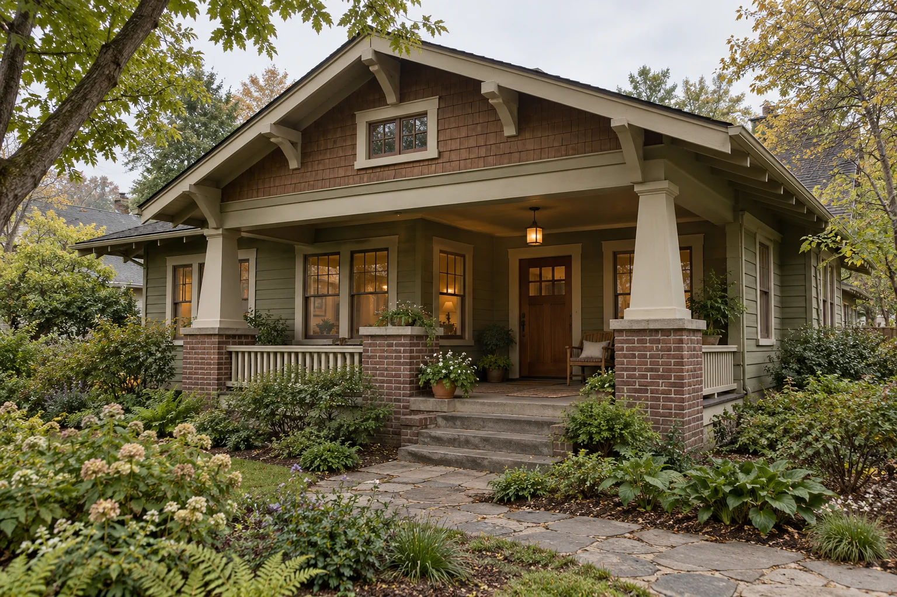
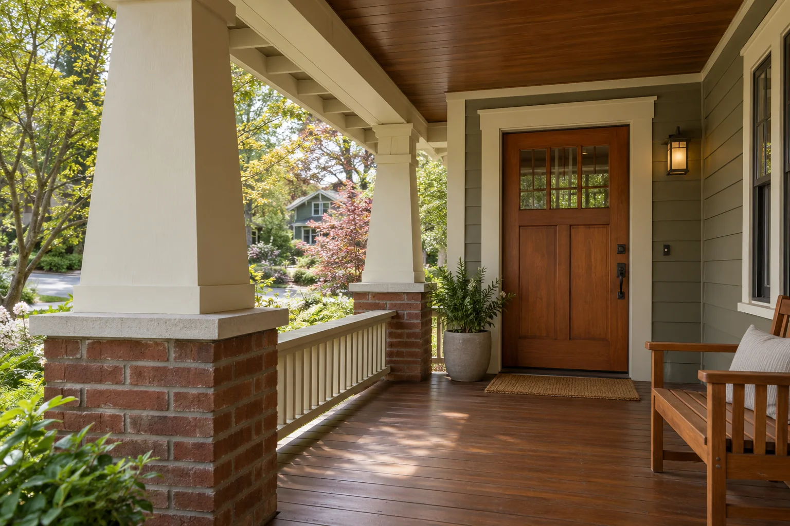
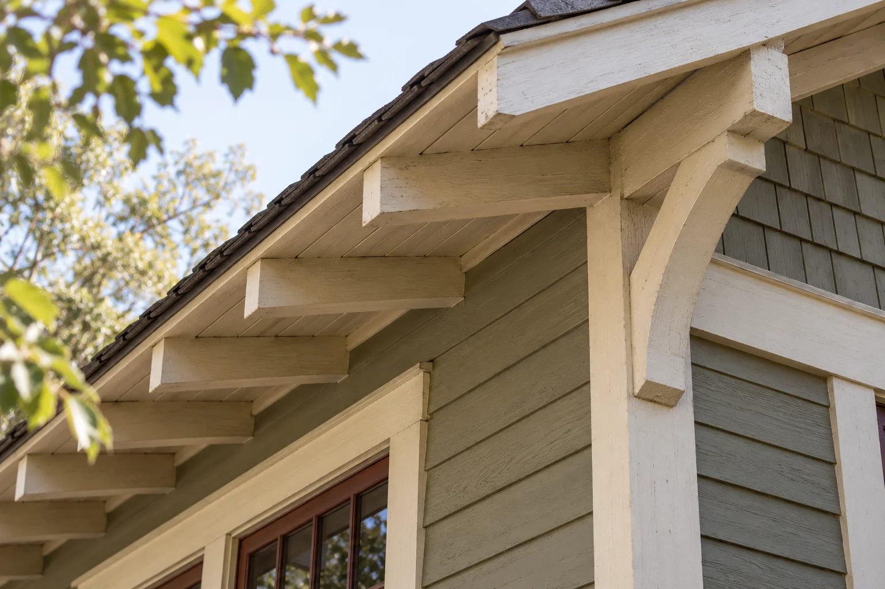
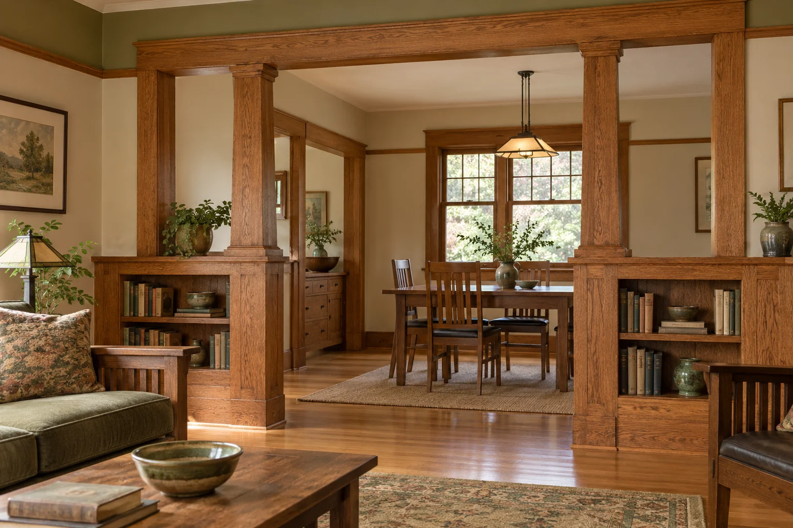
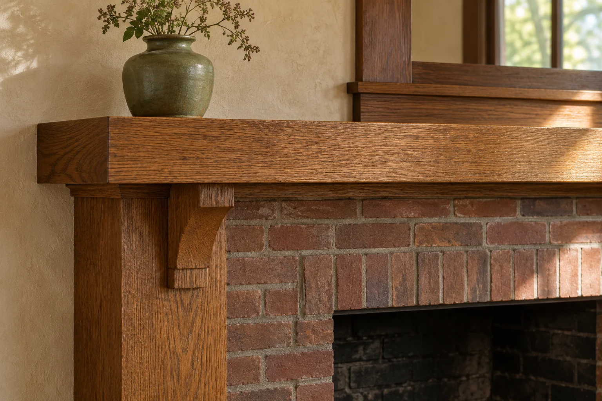

# Craftsman Architecture — approved reference

Approved by the user on 2026-10-25, including images and layout, as the reference template. Publication is explicitly on hold.

Canonical content: `content/design-library/craftsman.ts`. 1422 words of introduction/body prose, plus snapshot and recognition panels. Five generated architectural illustrations.

[Local preview](http://127.0.0.1:3002/design-library/architectural-styles/craftsman) · [Setup](PREVIEW.md) · [Image provenance and exact prompts](CRAFTSMAN-IMAGES.md)

A Craftsman house often makes its first impression through shelter: a roof reaching beyond the walls, a porch with substantial supports, a doorway held back in shade. Before you notice a particular bracket or window, you notice the relationship between the house and the place where you stand. Its character comes from those relationships as much as from its details.

### Illustration: A house beneath its roof

**Generated architectural illustration.** A broad roof and recessed porch establish the sheltered threshold characteristic of many Craftsman houses.

**Alt text:** view of a Craftsman bungalow showing broad eaves, a recessed porch, and masonry porch bases.

## At a glance

- **When:** Especially associated with the early 1900s through the 1920s.

- **The idea:** Architecture, furnishings, and materials considered together; craft made visible.

- **Look for:** A combination of sheltering roof, substantial porch, and expressive woodwork.

- **A broad roof:** A low-pitched roof and deep overhangs establish the silhouette.

- **Visible details:** Exposed rafter tails and brackets give the roof edge its rhythm.

- **A sheltered porch:** Square or tapered posts often meet brick or stone bases.

**One useful distinction:** Craftsman describes a design language. Bungalow describes a house form. They often overlap, but one does not guarantee the other.

Sources: [Pennsylvania Historical & Museum Commission](https://www.phmc.state.pa.us/portal/communities/architecture/styles/bungalow.html); [The Metropolitan Museum of Art](https://www.metmuseum.org/essays/the-arts-and-crafts-movement-in-america); [City of Houston](https://www.houstontx.gov/planning/HistoricPres/HistoricPreservationManual/historic_districts/freeland_arch.html)

## An argument about how things are made

Craftsman architecture belongs within the wider Arts and Crafts movement, whose British origins involved a critique of industrial labor and the quality of manufactured goods. Writers and designers including John Ruskin and William Morris connected the making of objects with larger questions about work and everyday life. The movement was never simply a prescription for brown wood and handmade tile. It asked what a well-made environment could mean for the people who produced it and lived within it.

In the United States, those ideas took several forms. Gustav Stickley helped give the Craftsman name a recognizable public identity through furniture and The Craftsman magazine, published from 1901 to 1916. His version of domestic design brought furnishings and architecture into the same conversation. The V&A describes American practice as generally more commercial than its European counterparts: an important reminder that shared ideals did not produce identical approaches on either side of the Atlantic.

Sources: [The Metropolitan Museum of Art](https://www.metmuseum.org/essays/the-arts-and-crafts-movement-in-america); [Victoria and Albert Museum](https://www.vam.ac.uk/articles/arts-and-crafts-beyond-the-uk)

## Craftsman is a style; bungalow is a form

The words overlap so frequently that they can seem interchangeable. They answer different questions. Bungalow describes a house form, commonly low in profile, with a prominent porch. Craftsman describes an architectural language that can appear on a bungalow or on a larger house. Houston’s preservation guidance explicitly identifies Craftsman details on other modest house forms as well. Calling every bungalow a Craftsman erases useful distinctions; calling every Craftsman a bungalow does the same.

When looking at a house, separate its organization from its treatment. First ask about height, roof arrangement, porch, and plan. Then look at the eaves, supports, window divisions, and materials. This two-step reading is more useful than finding one tapered column and assigning a style to the entire building. Alterations can complicate the evidence, so a label should remain open to revision when drawings, photographs, or closer inspection reveal more.

Sources: [City of Houston](https://www.houstontx.gov/planning/HistoricPres/HistoricPreservationManual/historic_districts/freeland_arch.html); [City of Longmont](https://longmontcolorado.gov/planning-and-development-services/historic-preservation/bungalow-style/)

### Illustration: The porch as a room

**Generated architectural illustration.** A porch is easier to understand in depth: roof, supports, and entrance together define the space between street and interior.

**Alt text:** porch view showing the sheltered route between steps and front door.

## Read the roof before the ornament

Broad overhangs, low-pitched roofs, exposed rafter ends, and substantial porch supports are recurring Craftsman features. The Pennsylvania architectural field guide records variations in roof form, columns, and cladding rather than one mandatory arrangement. A front gable is familiar, but side gables and hipped roofs also occur. Wood shingles and horizontal siding belong to the vocabulary alongside brick, stone, and stucco. The family resemblance matters more than a checklist completed in every example.

Look at the depth of the eave and the shadow it produces. Follow the porch supports downward: do their proportions feel connected to the base and roof above? Notice whether window groups reinforce the house’s horizontal rhythm. These are ways to understand a composition, rather than rules for copying it. A modest house may make its point with very little ornament, while another uses brackets and shaped timber ends more emphatically.

Consider the porch from within as well as from the street. Is there enough depth to sit beside the path to the door? Does a support frame a view or interrupt it? For a proposed alteration, draw the furniture and the route people will take before deciding where a new post belongs. A facade can look balanced on paper while the space behind it feels awkward to occupy. Testing both views helps keep the porch useful.

Visible woodwork can suggest construction without explaining it completely. Before describing a bracket as load-bearing, establish what it actually supports. For a renovation, this distinction becomes practical: an apparently decorative piece may conceal a connection, while an imposing beam may be applied trim. Appearance alone cannot settle a structural question.

Sources: [Pennsylvania Historical & Museum Commission](https://www.phmc.state.pa.us/portal/communities/architecture/styles/bungalow.html)

### Illustration: Where roof meets wall

**Generated architectural illustration.** An eave detail makes the relationship between roof, rafters, and wall easier to read; visible form alone does not establish structural function.

**Alt text:** close view of exposed rafter tails beneath an overhanging roof.

## Rooms with boundaries, and connections

The Pennsylvania guide describes interconnected rooms and an entrance that often leads directly into living space. That is a useful starting point, but it should not be confused with today’s completely open plan. When evaluating an interior, look for the devices that let adjacent spaces communicate while retaining their own scale: an opening, a change in ceiling treatment, or a piece of cabinetry that frames the view.

A built-in bookcase can do more than hold books. Positioned carefully, it gives an opening thickness and makes the transition between rooms feel deliberate. A window seat can turn the edge of a room into an inhabited place. These are useful design possibilities, not proof that every Craftsman house originally contained them. Surviving fabric and reliable records should guide any claim about a particular interior.

For new work, begin with the room’s alignments. A cabinet head that acknowledges a nearby doorway may feel more settled than one chosen solely to maximize storage. Consider the depth of shelves, the passage beside them, and what someone sees from the next room. The aim is a coherent room, not the largest possible collection of recognizable period details.

Sources: [Pennsylvania Historical & Museum Commission](https://www.phmc.state.pa.us/portal/communities/architecture/styles/bungalow.html)

### Illustration: An opening with depth

**Generated architectural illustration.** An opening framed by low cabinetry connects two rooms while preserving a sense of enclosure.

**Alt text:** Interior view through a wood-trimmed opening with low built-in bookcases and a dining room beyond.

## Material is part of the composition

Stickley’s Craftsman Farms offers a particularly direct example of material and setting considered together. The museum describes its Log House as using chestnut logs cut from the property and local stone. This is a specific building, not a universal materials schedule for the style. Its value as a reference lies in the relationship between the chosen materials, the place, and the architectural idea.

In an existing house, first identify what is there. Species, finish, previous repairs, and lighting all affect the appearance of wood. Do not assume a dark surface is a deliberate original stain, or that every painted component conceals wood intended for clear finishing. Investigation should precede a stripping or refinishing decision. A sample assessed in the actual room tells you more than a small swatch viewed elsewhere.

The same care applies to color. For a contemporary interpretation, muted greens, clay tones, warm neutrals, or deeper accents can be explored as design choices; they are not an authenticated palette for an individual house. If historical accuracy is the goal, use building-specific evidence and appropriate paint investigation. If adaptation is the goal, judge color beside the actual masonry, timber, daylight, and adjacent rooms.

Sources: [The Stickley Museum at Craftsman Farms](https://www.stickleymuseum.org/history/)

### Common colors & materials

| Color family | Illustrative digital swatch | Use |
| --- | --- | --- |
| Muted green | #74745f | A subdued, nature-related body color. |
| Earth brown | #6b5341 | Timber tones and darker painted surfaces. |
| Warm ochre | #a18350 | An earthy yellow-brown color family. |
| Brick red | #914f3f | Masonry color or a restrained accent. |
| Soft cream | #e9dfc9 | A lighter trim option in an illustrative scheme. |

- **Wood:** Horizontal siding or shingles outside; trim and cabinetry within.
- **Brick & stone:** Often visible in porch bases, chimneys, and fireplace surrounds.
- **Stucco:** Another documented exterior finish; wood cladding is not universal.
- **Divided-light glass:** Multi-pane windows contribute to the pattern of the facade.

These swatches illustrate color families, not authenticated paint matches or one universal historic palette. Long Beach’s preservation guide describes darker, neutral, and earth-toned finishes historically, and lighter schemes in later use. Color alone does not identify a Craftsman house; judge the form and details together.

Sources: [City of Long Beach](https://www.longbeach.gov/globalassets/lbcd/media-library/documents/planning/historic-preservation/district-maps/guidelines/chapter-4-3_craftsman); [Pennsylvania Historical & Museum Commission](https://www.phmc.state.pa.us/portal/communities/architecture/styles/bungalow.html)

### Illustration: Wood, masonry, and reflected light

**Generated architectural illustration.** A material study should show how surfaces meet and receive light, rather than imply one universal Craftsman palette.

**Alt text:** material study of wood trim beside a masonry fireplace surround.

## Two examples, different ambitions

The Gamble House in Pasadena demonstrates the reach of a highly individual architectural commission. Designed by Charles and Henry Greene, it belongs to a different scale of patronage from the ordinary neighborhood bungalow. The Gamble House’s own timeline dates the beginning of construction to March 1908 and completion to January 1909. Its broader cultural context includes Japanese influence, discussed in Houston’s account of the Greene brothers’ work. That influence deserves specific attention rather than being treated as a vague synonym for simplicity.

Craftsman Farms in New Jersey offers another point of reference. Stickley initially conceived its main house as a gathering place associated with a proposed farm school, before adapting it for his family. Read alongside the Gamble House, it helps dispel the idea that Craftsman architecture was one fixed plan or price point. For a homeowner, neither example needs to become a shopping list. Study a particular relationship—a threshold, a material transition, a window and its surrounding woodwork—and ask why it works in that building.

Sources: [The Huntington](https://www.huntington.org/exhibition/new-and-native-beauty-art-and-craft-greene-greene); [The Gamble House](https://gamblehouse.org/construction-begins/); [City of Houston](https://www.houstontx.gov/planning/HistoricPres/HistoricPreservationManual/historic_districts/freeland_arch.html); [The Stickley Museum at Craftsman Farms](https://www.stickleymuseum.org/history/)

## Carry the logic forward

A useful contemporary interpretation begins with the house you have. Decide what deserves preservation, what is a later alteration, and what daily life now requires. Those questions may lead to a restrained addition, improved lighting, or carefully fitted storage rather than a complete stylistic makeover. Record existing conditions before removing anything; once a detail is gone, a photograph may be the only evidence of how it met its neighbors.

Scale is an especially useful test. A new mantel can borrow the broad outlines of a Craftsman example and still overwhelm a smaller room. A thick casing can look convincing in isolation yet crowd a corner or conflict with a nearby window. Test the proposal through elevations, samples, or a full-size mock-up where appropriate. Look from seated positions as well as from the doorway.

Comfort also depends on things the style label does not resolve: reading light, storage needs, usable passages, and the practicalities of maintenance. Let those needs shape the intervention. Concealed equipment and discreet contemporary lighting can be considered without inventing a historical justification for them. Where new work meets old, aim for a clear, respectful relationship and describe it honestly.

The most useful lesson of Craftsman architecture is a habit of attention. Notice how a roof shelters an entrance, how an opening sets the scale of a room, and how two materials meet. An addition earns its place when those relationships improve. Recognizable details can contribute, but they cannot do that work on their own.

## Source verification record

| Source | Verification scope |
| --- | --- |
| [The Metropolitan Museum of Art: The Arts and Crafts Movement in America](https://www.metmuseum.org/essays/the-arts-and-crafts-movement-in-america) | Monica Obniski, 2008. British intellectual origins and the wider American movement. |
| [Victoria and Albert Museum: Arts and Crafts: beyond the UK](https://www.vam.ac.uk/articles/arts-and-crafts-beyond-the-uk) | Stickley, The Craftsman (1901–1916), and the commercial context of American practice. |
| [Pennsylvania Historical & Museum Commission: Bungalow/Craftsman Style 1900–1930](https://www.phmc.state.pa.us/portal/communities/architecture/styles/bungalow.html) | Archived architectural field guide: exterior vocabulary, material variation, and connected rooms. |
| [City of Houston: Freeland: Architectural Styles](https://www.houstontx.gov/planning/HistoricPres/HistoricPreservationManual/historic_districts/freeland_arch.html) | Distinguishes house form from Craftsman details; discusses the Greenes and Japanese influence. |
| [City of Longmont: Bungalow Style](https://longmontcolorado.gov/planning-and-development-services/historic-preservation/bungalow-style/) | Bungalow scale and roof/porch variations in a regional preservation context. |
| [The Stickley Museum at Craftsman Farms: History](https://www.stickleymuseum.org/history/) | Log House materials, original intended use, and adaptation for the Stickley family. |
| [The Gamble House: Construction Begins](https://gamblehouse.org/construction-begins/) | Construction chronology: March 1908 to January 1909. |
| [The Huntington: A New and Native Beauty: The Art and Craft of Greene & Greene](https://www.huntington.org/exhibition/new-and-native-beauty-art-and-craft-greene-greene) | Gamble House architect attribution and the Greenes’ coordinated architecture and furnishings. |
| [City of Long Beach: Craftsman Style Guide: Paint Colors](https://www.longbeach.gov/globalassets/lbcd/media-library/documents/planning/historic-preservation/district-maps/guidelines/chapter-4-3_craftsman) | Page 12: historical dark, neutral, and earth-toned exterior finishes; lighter later schemes. Swatches here are editorial approximations, not historic color specifications. |

## Publication status

No publication, push, or deployment is authorized. Craftsman is the approved reference; Victorian is also approved. No third article has been started.
