# Victorian Architecture — approved review copy

The user approved this article, its layout, five main images, and six snapshot thumbnails on 2026-10-25. Publication is on hold.

Canonical content: `content/design-library/victorian.ts`. 1412 words of introduction/body prose, plus snapshot and recognition panels. Five generated architectural illustrations.

[Local preview](http://127.0.0.1:3002/design-library/architectural-styles/victorian) · [Setup](PREVIEW.md) · [Image provenance and exact prompts](VICTORIAN-IMAGES.md)

A bracket beneath an eave, a bay that turns toward the street, a porch worked into a delicate screen: Victorian houses invite you to look closely. Yet the label tells you less than it first appears to. A quiet Italianate house and a richly textured Queen Anne can both be Victorian. Understanding the difference makes their details more interesting—and decisions about their future more thoughtful.

### Illustration: A Queen Anne reading of the Victorian house

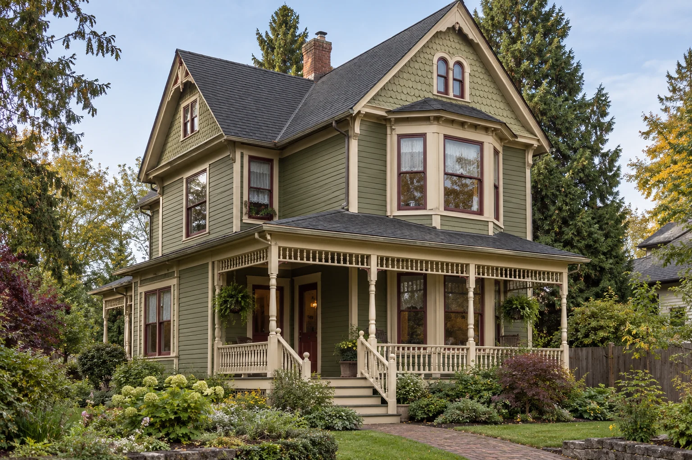

**Generated architectural illustration.** Cross gables, a projecting bay, patterned shingles, and a light porch screen give this Queen Anne illustration its layered character.

**Alt text:** Olive-painted Queen Anne house with cross gables, a polygonal bay, patterned shingles, and a porch with turned posts.

## At a glance

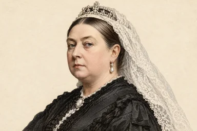

- **When:** The name refers to Victoria’s reign, 1837–1901; American style dates overlap and sometimes extend later.

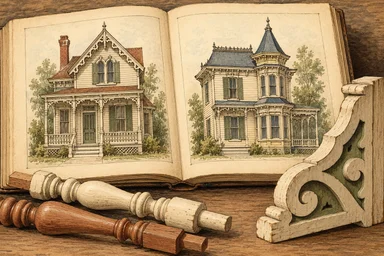

- **The idea:** An era of several styles, shared through publications and an expanding market for architectural ornament.

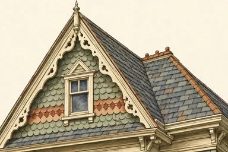

- **First question:** Which Victorian language does this house speak? Start with its roof and overall form.

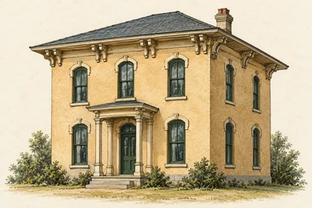

- **Italianate:** Low roof, bracketed cornice, and tall, narrow windows.

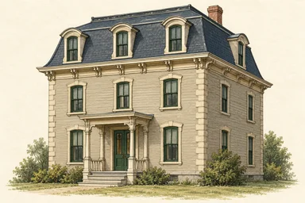

- **Second Empire:** A mansard roof with a steep lower slope and dormer windows.

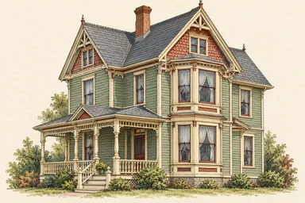

- **Queen Anne:** An irregular silhouette, projecting bays, porches, and varied wall textures.

Thumbnail illustrations generated for this guide; Victoria’s portrait is an imagined historical likeness.

[Thumbnail prompts and provenance](VICTORIAN-SNAPSHOT-IMAGES.md)

**One useful distinction:** Victorian is an umbrella term, not one style. A tower is not required, and a colorful paint scheme does not establish a house’s age or identity.

Sources: [The Royal Family](https://www.royal.uk/encyclopedia/victoria-r-1837-1901); [Pennsylvania Historical & Museum Commission](https://www.phmc.state.pa.us/portal/communities/architecture/styles/italianate.html); [Pennsylvania Historical & Museum Commission](https://www.phmc.state.pa.us/portal/communities/architecture/styles/second-empire.html); [Pennsylvania Historical & Museum Commission](https://www.phmc.state.pa.us/portal/communities/architecture/styles/queen-anne.html)

## An era, rather than a single style

The Victorian era takes its name from Queen Victoria, who reigned in Britain from 1837 to 1901. American architectural usage gathers several nineteenth-century styles beneath that label. Their timelines do not fit neatly inside the reign: Pennsylvania’s architectural field guide, for example, dates Queen Anne from 1880 to 1910. The term is useful as an introduction, but a specific style name usually explains a building more precisely.

That distinction changes how you look. Symmetry, roof shape, window proportions, wall texture, and the treatment of the porch can tell different stories within the same broad period. An ornate bracket is one piece of evidence, not a complete diagnosis. Begin with the whole building, then move closer. A later porch or replacement window may be a chapter in its history rather than a reliable guide to its original design.

Sources: [The Royal Family](https://www.royal.uk/encyclopedia/victoria-r-1837-1901); [Pennsylvania Historical & Museum Commission](https://www.phmc.state.pa.us/portal/communities/architecture/styles/queen-anne.html)

## Italianate: the cornice sets the rhythm

Italianate architecture draws on a romantic interpretation of Italian buildings. Its recurring signals are a relatively low roof, a pronounced cornice with brackets, and tall, narrow windows. Elaborate window heads may be arched or framed by small pediments. A square tower belongs to some villa examples, but it is not necessary to identify the broader style. The Pennsylvania guide also records its use in townhouses and commercial buildings as well as freestanding houses.

Read the spacing of brackets and windows together. In a successful composition, the upper edge gives the wall a deliberate finish, while the openings sustain its vertical proportions. A replacement window of a different shape can change that balance even when its dimensions seem only slightly different. For contemporary work, this is a reason to study the entire elevation before choosing trim from an isolated photograph.

Sources: [Pennsylvania Historical & Museum Commission](https://www.phmc.state.pa.us/portal/communities/architecture/styles/italianate.html)

### Illustration: The bracketed cornice

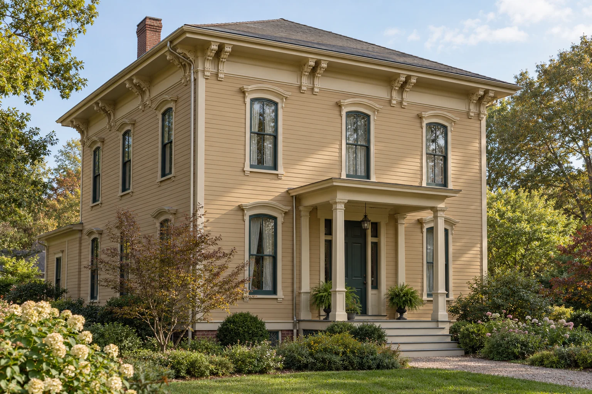

**Generated architectural illustration.** A low roof and bracketed cornice distinguish this Italianate illustration from the steeper Queen Anne silhouette.

**Alt text:** Italianate house with a low hipped roof, paired cornice brackets, tall windows, and a restrained entry porch.

## Second Empire: start at the mansard

The mansard roof is the clearest starting point for Second Empire architecture. Its steep lower slope, commonly punctuated by dormer windows, allows usable space within the roof. The style takes its name from France’s Second Empire under Napoleon III. It shares some bracketed cornices and other details with Italianate buildings, but the roof gives it a different profile. Decorative dormers and iron cresting may reinforce that silhouette without being present in every example.

When comparing houses, draw the roof outline before drawing any ornament. The exercise makes the difference between a mansard and a conventional steep gable immediately legible. It also helps explain why adding elaborate trim to an unrelated building cannot reproduce the same architectural effect. The form establishes the character that the ornament elaborates.

Sources: [Pennsylvania Historical & Museum Commission](https://www.phmc.state.pa.us/portal/communities/architecture/styles/second-empire.html)

### Illustration: A roof that contains a story

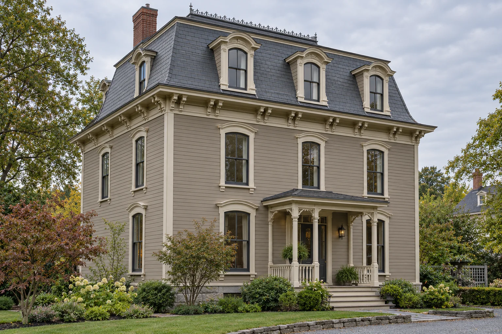

**Generated architectural illustration.** Dormers occupy the steep lower slope of the mansard in this Second Empire illustration.

**Alt text:** Second Empire house with a slate-colored mansard roof, dormer windows, bracketed cornice, and a small entry porch.

## Queen Anne: a composition of projections and textures

Queen Anne is the image many Americans associate most readily with a Victorian house. Look for an irregular roofline, an asymmetrical facade, projecting bays, and a porch that negotiates those changes in form. Patterned shingles or other changes in surface texture can distinguish a gable from the wall beneath it. Some examples have towers, but the style also works at the scale of a modest house. Its identity does not depend on a turret.

The layers matter because they change what you see as you move. A bay catches light from another direction; a porch partly screens the entrance; a change in cladding gives an upper wall a different visual weight. For a homeowner, those relationships are more useful to understand than the idea that Victorian architecture simply means adding more decoration. An overcomplicated paint scheme can make a thoughtful composition harder to read.

Sources: [Pennsylvania Historical & Museum Commission](https://www.phmc.state.pa.us/portal/communities/architecture/styles/queen-anne.html)

## Gothic, Stick, and Shingle: different kinds of emphasis

Gothic Revival turns attention toward steep gables and pointed openings. Clackamas County’s historical guide describes regional houses with jigsawn porch and eave trim, alongside plainer vernacular adaptations. A simple farmhouse may therefore share an architectural lineage with a more elaborate example without carrying the same amount of ornament. The absence of delicate trim today does not, by itself, reveal what was originally present.

Stick style emphasizes bands of applied wood arranged vertically, horizontally, or diagonally across wall surfaces and gables. These lines should not automatically be described as exposed framing: the Pennsylvania guide identifies the stickwork as decorative trim. Shingle style takes another approach, giving greater continuity to the wall surface through wood shingles. Historic Wallingford describes Pacific Northwest examples from the late 1890s and early 1900s, with less emphasis on individually accented details.

These distinctions are useful when a house has been altered. A new layer of siding can conceal a patterned surface; a simplified porch can obscure an earlier rhythm. Before recreating missing ornament, look for photographs or physical evidence of its position and scale. Guessing from a neighbor’s house risks exchanging one building’s character for another’s.

Sources: [Clackamas County](https://www.clackamas.us/planning/historicclackamas.html); [Pennsylvania Historical & Museum Commission](https://www.phmc.state.pa.us/portal/communities/architecture/styles/stick.html); [Historic Wallingford](https://www.historicwallingford.org/learn/architecture-styles/)

### Illustration: Pattern made with wood

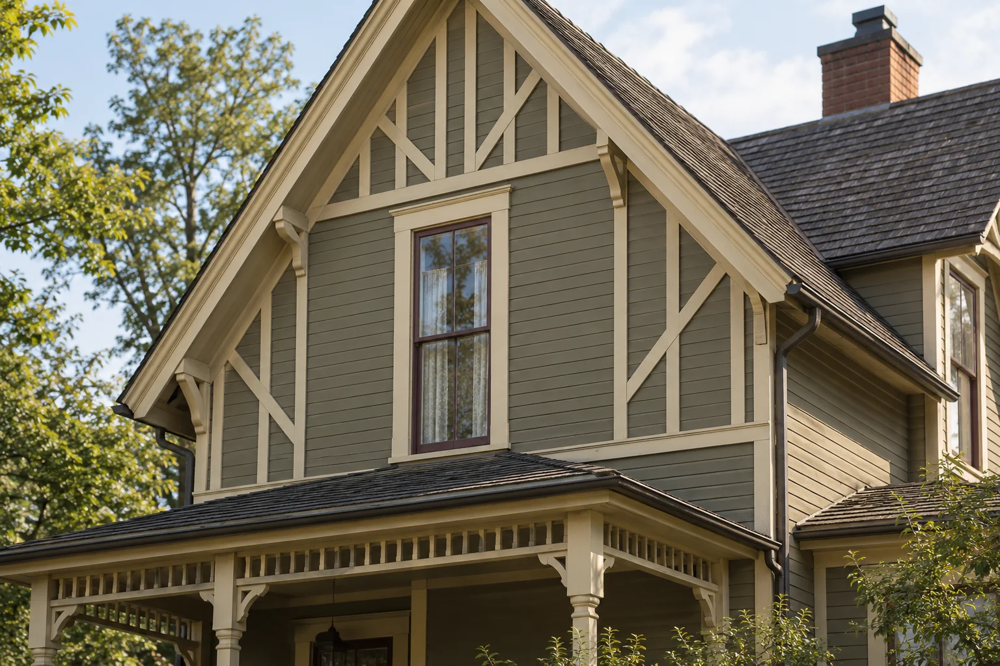

**Generated architectural illustration.** Applied boards and a textured gable demonstrate a decorative surface treatment; they are not a diagram of structural framing.

**Alt text:** Close view of a wood-sided Victorian gable with applied trim boards and carefully fitted decorative details.

## Materials and color: give the parts a hierarchy

A Victorian color scheme should help explain the building. Decide which surfaces belong to the body, which elements define edges, and which details deserve emphasis. Giving every molding a separate color can fragment a facade. A smaller number of well-related tones may make its depth and proportions more evident, even when the building contains a great deal of ornament.

Historical palettes were not uniform. Ipswich’s municipal color guide describes relatively restrained early treatments and increasingly varied later schemes, including earth-derived colors and darker accents. Inside, the National Park Service records changing preferences for paint, stains, and clear finishes. For an individual house, a dated photograph or careful finish investigation is more persuasive than a palette marketed under a period name. Distinguish a contemporary interpretation from a restoration to a documented date.

Sources: [Ipswich Historical Commission](https://www.ipswichma.gov/DocumentCenter/View/10184/Part-II---Victorian-1840-1900); [National Park Service](https://www.nps.gov/orgs/1739/upload/preservation-brief-28-painting-interiors.pdf)

### Common colors & materials

| Color family | Illustrative digital swatch | Use |
| --- | --- | --- |
| Warm buff | #c5ad83 | A restrained neutral color family. |
| Ochre | #a98645 | An earthy yellow-brown for layered schemes. |
| Olive | #717451 | A muted green, rather than a uniformly bright palette. |
| Russet | #884d3c | A deeper red-brown color family. |
| Deep green | #34473e | A dark accent option for sash and doors. |

- **Wood siding & shingles:** Clapboards and patterned shingles can distinguish adjoining wall areas.
- **Milled wood trim:** Brackets, turned porch elements, and applied boards vary by style.
- **Brick & stone:** Masonry examples exist; a Victorian house need not be wood-framed.
- **Glass & plaster:** Decorative glazing in some houses; plaster and finished wood within.

These are illustrative color families, not a single Victorian palette or documented paint matches. Ipswich’s historical color guide distinguishes quieter early schemes from stronger later contrasts. Region, date, style, and surviving evidence matter more than a generic color chart.

Sources: [Ipswich Historical Commission](https://www.ipswichma.gov/DocumentCenter/View/10184/Part-II---Victorian-1840-1900); [Pennsylvania Historical & Museum Commission](https://www.phmc.state.pa.us/portal/communities/architecture/styles/queen-anne.html); [National Park Service](https://www.nps.gov/orgs/1739/upload/preservation-brief-28-painting-interiors.pdf)

## Read the interior as a sequence

An interior deserves the same attention to relationships as the facade. Look at the entrance, the stair, the openings between rooms, and the way trim meets a mantel or a built-in. A staircase can organize a hall visually as well as physically. A pair of doors can make two rooms feel connected while preserving their separate scale. These are observations to make in the actual building, not features guaranteed by a Victorian label.

For adaptation, begin with the activities that need accommodation. A reading room may need better task lighting rather than a removed partition. A dining room may benefit from storage fitted around an existing opening rather than a new wall of unrelated cabinetry. Lay out furniture and circulation before deciding that every boundary is an obstacle. Conversely, an alteration may be useful when the existing arrangement cannot serve the household well. Document what matters before changing it.

Avoid assuming that every interior surface should become either exposed wood or white paint. Surviving finishes and the character of the room should inform the choice. Work with samples viewed beside the actual floor, wall, and daylight; a finish that looks convincing on its own can behave very differently across a whole room.

Sources: [National Park Service](https://www.nps.gov/orgs/1739/upload/preservation-brief-28-painting-interiors.pdf)

### Illustration: The stair gives the hall its structure

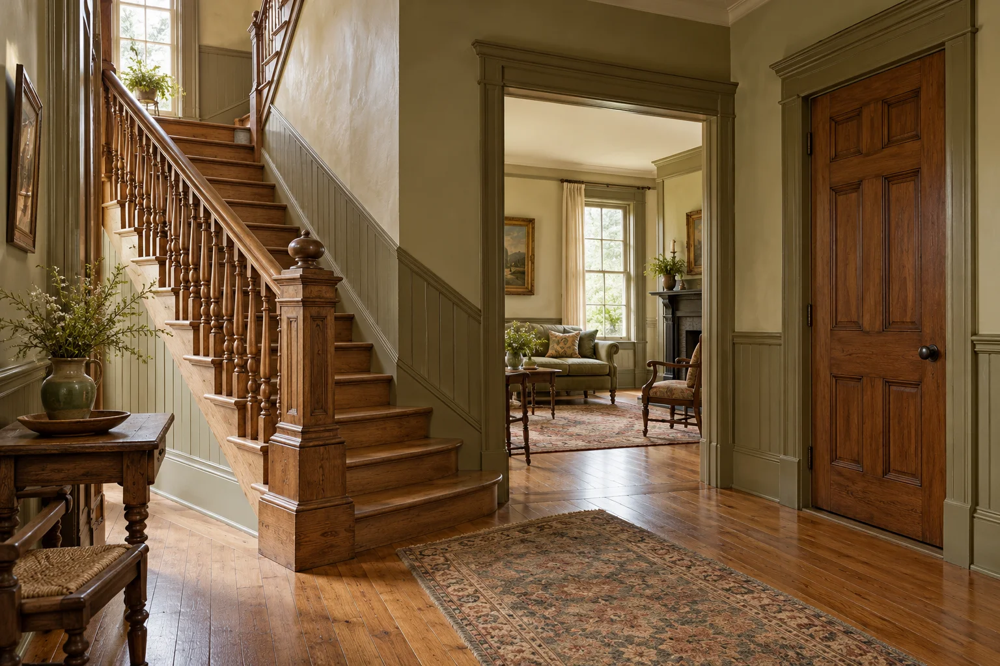

**Generated architectural illustration.** A stair, door surrounds, and connected openings establish the scale of this illustrative interior without recreating a named historic room.

**Alt text:** Victorian-inspired entrance hall with a wood staircase, turned balusters, plaster walls, and a view into an adjoining room.

## A Northwest history with local variations

Victorian architecture in the Pacific Northwest belongs to local building histories, not simply to an imported picture-book image. Clackamas County’s guide identifies Italianate houses in Oregon during the 1870s and 1880s, followed by Queen Anne’s popularity in the 1890s. Its account describes how manufactured ornament reached even relatively modest houses. The result was variation in ambition, budget, and detail within the same architectural family.

Two Oregon museum houses offer specific points of reference: the Shelton McMurphey Johnson House in Eugene, built in 1888 and identified by its museum as Queen Anne Revival; and Deepwood in Salem, built in 1894 for Dr. Luke A. Port to a design by William C. Knighton. Deepwood’s own history records later alterations as well. Such buildings are useful precisely because their documented lives are more complicated than one style label. The generated figures in this article do not depict either property.

Sources: [Clackamas County](https://www.clackamas.us/planning/historicclackamas.html); [Shelton McMurphey Johnson House](https://smjhouse.org/support/memberships/); [Deepwood Museum & Gardens](https://deepwoodmuseum.org/about/families/)

## Living with the house you have

The most useful starting point is a measured account of the building in front of you. Identify its style or combination of styles, distinguish surviving details from replacements, and decide which relationships give it character. A missing bracket, an awkward light fixture, and an impractical kitchen are different problems. They need not all be answered by the same degree of intervention.

New work can be contemporary while acknowledging the house’s scale, alignments, and material transitions. What matters is that the choice has a reason and is described honestly. Study where an addition meets the existing wall, how a new opening sits beside an old one, and whether a storage element respects a room’s usable space. A Victorian house becomes easier to live with when its history informs those decisions without substituting for them.

## Source verification record

| Source | Verification scope |
| --- | --- |
| [The Royal Family: Victoria (r. 1837–1901)](https://www.royal.uk/encyclopedia/victoria-r-1837-1901) | Reign dates; architectural style dates are treated separately. |
| [Pennsylvania Historical & Museum Commission: Italianate Villa/Italianate Style 1840–1885](https://www.phmc.state.pa.us/portal/communities/architecture/styles/italianate.html) | Bracketed cornices, windows, roofs, and variations in form. |
| [Pennsylvania Historical & Museum Commission: Second Empire/Mansard Style 1860–1900](https://www.phmc.state.pa.us/portal/communities/architecture/styles/second-empire.html) | French context and identifying mansard/dormer features. |
| [Pennsylvania Historical & Museum Commission: Queen Anne Style 1880–1910](https://www.phmc.state.pa.us/portal/communities/architecture/styles/queen-anne.html) | Massing, roof, porch, texture, and dissemination. |
| [Pennsylvania Historical & Museum Commission: Stick Style 1860–1890](https://www.phmc.state.pa.us/portal/communities/architecture/styles/stick.html) | Applied decorative woodwork distinguished from structural framing. |
| [Clackamas County: A guide to historic building types and architectural styles in Clackamas County](https://www.clackamas.us/planning/historicclackamas.html) | Oregon chronology, Gothic vernacular adaptation, and manufactured ornament. |
| [Historic Wallingford: Residential Architecture: Styles and Forms](https://www.historicwallingford.org/learn/architecture-styles/) | Regional Shingle-style examples and emphasis on continuous wall surfaces. |
| [Ipswich Historical Commission: Part II: Victorian 1840–1900](https://www.ipswichma.gov/DocumentCenter/View/10184/Part-II---Victorian-1840-1900) | Historical color-family distinctions. Swatches in this article are illustrative, not exact matches. |
| [National Park Service: Preservation Brief 28: Painting Historic Interiors](https://www.nps.gov/orgs/1739/upload/preservation-brief-28-painting-interiors.pdf) | Sara B. Chase. Historic surface/finish variation and investigation. Contemporary design suggestions in this article are editorial analysis. |
| [Shelton McMurphey Johnson House: Memberships: About the House](https://smjhouse.org/support/memberships/) | Museum identifies the 1888 house as Late Victorian Queen Anne Revival. |
| [Deepwood Museum & Gardens: Families of Deepwood](https://deepwoodmuseum.org/about/families/) | 1894 construction for the Port family, Knighton attribution, and later renovations. |

## Editorial review notes

Please review the subtype comparisons, regional context, color/material guide, and illustrations. Museum and preservation sources were checked on 2026-10-25. Ipswich municipal PDF text and the SMJ museum description were verified through indexed first-party text; direct requests redirected/timed out. No source wording or picture rights are invented. Contemporary adaptation advice is editorial analysis. The illustrations do not depict the named museum houses.

## Publication status

No publication, push, or deployment is authorized. Craftsman is the approved reference; Victorian is also approved. No third article has been started.
